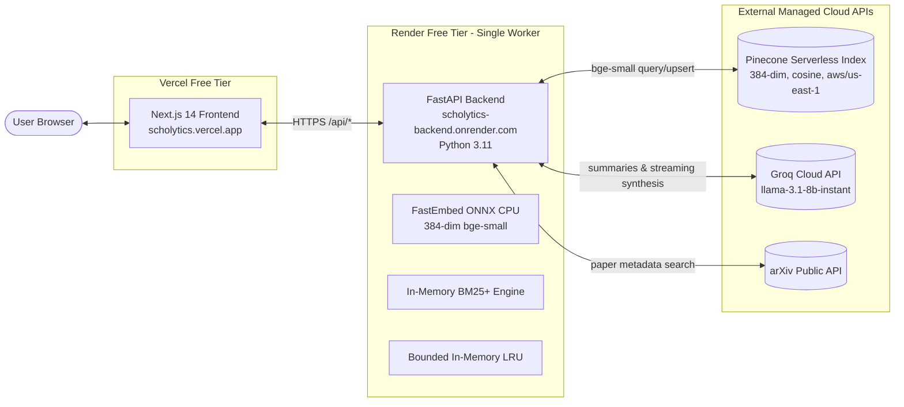

# Scholytics Production Deployment Guide: Render & Vercel

This guide documents the end-to-end production deployment of Scholytics with **Render** hosting the FastAPI backend and **Vercel** hosting the Next.js frontend, backed by **Pinecone Serverless** as the persistent vector store.

---

## 1. Production Architecture Overview



---

## 2. Pinecone Index Setup (Pre-requisite)

1. Sign up or log in to the [Pinecone Console](https://app.pinecone.io).
2. Create an API key under **API Keys** and copy the value (starts with `pcsk_...`).
3. Click **Create Index**:
   - **Index Name**: `scholytics-papers` (or custom name)
   - **Dimensions**: `384` *(MANDATORY: matches FastEmbed `bge-small-en-v1.5`)*
   - **Metric**: `cosine` *(MANDATORY: used for cosine similarity scoring)*
   - **Index Type**: `Serverless`
   - **Cloud Provider**: `AWS`
   - **Region**: `us-east-1` (Free starter region)
4. Wait for the index status to display **Ready**.

> [!IMPORTANT]
> Do NOT create an index with dimension 768 or 1536. FastEmbed generates 384-dimensional embeddings.
> Metric MUST be `cosine` (not euclidean or dotproduct). The backend validates this upon startup and rejects misconfigured indexes.

---

## 3. Render Deployment (FastAPI Backend)

### Method A: One-Click Infrastructure-as-Code Blueprint (Recommended)
This repository contains a `render.yaml` blueprint:
1. Log in to [dashboard.render.com](https://dashboard.render.com).
2. Click **Blueprints** $\rightarrow$ **New Blueprint Instance**.
3. Connect your repository. Render automatically reads `render.yaml`.
4. Fill in the three secret values marked `sync: false`:
   - `PINECONE_API_KEY`: your `pcsk_...` key
   - `GROQ_API_KEY`: your `gsk_...` key
   - `FRONTEND_ORIGIN`: your Vercel URL (e.g. `https://scholytics.vercel.app`)
5. Click **Apply**.

### Method B: Manual Web Service Setup
1. Click **New +** $\rightarrow$ **Web Service**.
2. Select your repository.
3. Configure the following fields:
   - **Name**: `scholytics-backend`
   - **Runtime**: `Python`
   - **Region**: `Oregon (US West)` or `Ohio (US East)`
   - **Branch**: `main`
   - **Build Command**: `pip install -r backend/requirements.txt`
   - **Start Command**: `uvicorn main:app --host 0.0.0.0 --port $PORT --app-dir backend`
   - **Health Check Path**: `/health/live`
   - **Plan**: `Free`
4. Add the required Environment Variables listed below.

### Backend Environment Variables Table

| Variable Name | Required | Default / Recommended Value | Description |
| :--- | :---: | :--- | :--- |
| `PYTHON_VERSION` | **Yes** | `3.11.10` | Render defaults to Python 3.13 where FastEmbed wheels fail. Must be 3.11.x. |
| `ENVIRONMENT` | **Yes** | `production` | Enables production safeguards; prevents silent fallback to ephemeral Chroma. |
| `VECTOR_STORE_BACKEND` | **Yes** | `pinecone` | Mandatory for persistent storage across Render container restarts. |
| `PINECONE_API_KEY` | **Yes** | `pcsk_...` | Pinecone secret API key. Never expose in frontend! |
| `PINECONE_INDEX_NAME` | **Yes** | `scholytics-papers` | Target Pinecone serverless index name. |
| `GROQ_API_KEY` | **Yes** | `gsk_...` | Groq API key for Llama 3.1 8B summarization & streaming synthesis. |
| `GROQ_MODEL` | No | `llama-3.1-8b-instant` | Groq model selection. |
| `FRONTEND_ORIGIN` | **Yes** | `https://scholytics.vercel.app` | Allowed CORS origin. Supports comma-separated list. |
| `ENABLE_CACHE` | No | `true` | Bounded LRU in-memory cache (<5MB RAM). |
| `ENABLE_RERANKER` | No | `false` | Keep `false` on Render free tier (512MB RAM limit). |

---

## 4. Vercel Deployment (Next.js Frontend)

1. Log in to [vercel.com](https://vercel.com) and click **Add New...** $\rightarrow$ **Project**.
2. Import your GitHub repository.
3. Configure project settings:
   - **Framework Preset**: `Next.js`
   - **Root Directory**: `frontend` *(Click Edit and select the `frontend` folder)*
   - **Build Command**: `npm run build`
   - **Output Directory**: `.next`
4. Expand **Environment Variables** and configure:

| Variable Name | Required | Example Production Value | Description |
| :--- | :---: | :--- | :--- |
| `NEXT_PUBLIC_API_URL` | **Yes** | `https://scholytics-backend.onrender.com` | Live Render backend URL (no trailing slash). |

5. Click **Deploy**.

> [!WARNING]
> **Strict Secret Isolation Policy**:
> NEVER set `NEXT_PUBLIC_PINECONE_API_KEY` or `NEXT_PUBLIC_GROQ_API_KEY` in Vercel.
> Any variable prefixed with `NEXT_PUBLIC_` is baked into client-side JavaScript bundles and publicly visible to anyone inspecting network traffic. All credentials must reside strictly on Render.

---

## 5. Safe Corpus Seeding, Ingestion & Recovery

Because Render free tier operates with a single worker and 512MB RAM, initial seeding should be done in controlled batches without hammering arXiv:

### Initial Seeding from Local CLI
Run the ingestion CLI using your production Pinecone credentials:

```bash
# 1. Activate your virtual environment
.venv\Scripts\activate

# 2. Set production credentials in your local shell
set VECTOR_STORE_BACKEND=pinecone
set PINECONE_API_KEY=pcsk_your_key_here
set PINECONE_INDEX_NAME=scholytics-papers

# 3. Verify connection and current vector count
python backend/scripts/ingest_corpus.py --status

# 4. Ingest foundational AI/ML research topics
python backend/scripts/ingest_corpus.py --topics "deep learning transformers" "retrieval augmented generation" "diffusion generative models" --max-per-topic 10 --delay 3.0
```

### Ingestion Recovery & Idempotence
- **Interrupted Ingestion**: The ingestion coordinator records SHA-256 content fingerprints and canonical arXiv IDs. If an ingestion pass is cancelled or times out, re-running the command automatically skips already-indexed papers (`embeddings avoided!`) and resumes from where it stopped.
- **Corrupted / Stale Vectors**: To reset the index cleanly:
  ```python
  from db.pinecone_adapter import PineconeAdapter
  adapter = PineconeAdapter()
  adapter.reset()  # Calls delete_all=True on default namespace
  ```

---

## 6. Pre-Deployment Verification

Run the automated pre-deployment validator locally before pushing:

```bash
# Verify development configuration
.venv\Scripts\python backend/scripts/validate_config.py --env development

# Verify production configuration & secrets hygiene
.venv\Scripts\python backend/scripts/validate_config.py --env production

# Optionally verify live Pinecone index parameters
.venv\Scripts\python backend/scripts/validate_config.py --env production --live
```

---

## 7. Production Deployment Smoke-Test Checklist

Verify each critical workflow against the live deployment:

- [ ] **1. Process Liveness**:
  - Request: `GET https://your-backend.onrender.com/health/live`
  - Expected: HTTP `200` with `{"status": "alive", "version": "1.0.0"}`.
- [ ] **2. Dependency Readiness**:
  - Request: `GET https://your-backend.onrender.com/health/ready`
  - Expected: HTTP `200` with `"status": "ready"`, `"vector_store": "ok"`, `"vector_store_backend": "pinecone"`, `"groq_configured": true`.
- [ ] **3. Paper Search & Retrieval**:
  - Open `https://your-frontend.vercel.app` and search `"attention is all you need"`.
  - Expected: Results appear in <1.5s with cosine similarity scores, author lists, and category tags.
- [ ] **4. Pinecone Vector Upsert**:
  - Check `GET https://your-backend.onrender.com/api/ingest/status`.
  - Expected: Vector count reflects discovered and indexed papers.
- [ ] **5. Streaming Synthesis & Citations**:
  - Click **Generate Synthesis** on the search results page.
  - Expected: Groq streams markdown text via SSE; citation sources are validated and rendered with links.
- [ ] **6. Paper Comparison Matrix**:
  - Select 2 to 4 papers and click **Compare Papers**.
  - Expected: Comparison modal renders research questions, methods, findings, and limitations in a dark-themed table.
- [ ] **7. Interactive D3 Graph**:
  - Navigate to `/graph`.
  - Expected: Relationship nodes render smoothly with zoom, pan, and category filtering.
- [ ] **8. CORS & Redaction**:
  - Inspect backend Render logs.
  - Expected: Trace IDs (`[req-...]`) appear on all logs; all keys are scrubbed (`gsk_[REDACTED]`, `pcsk_[REDACTED]`).
