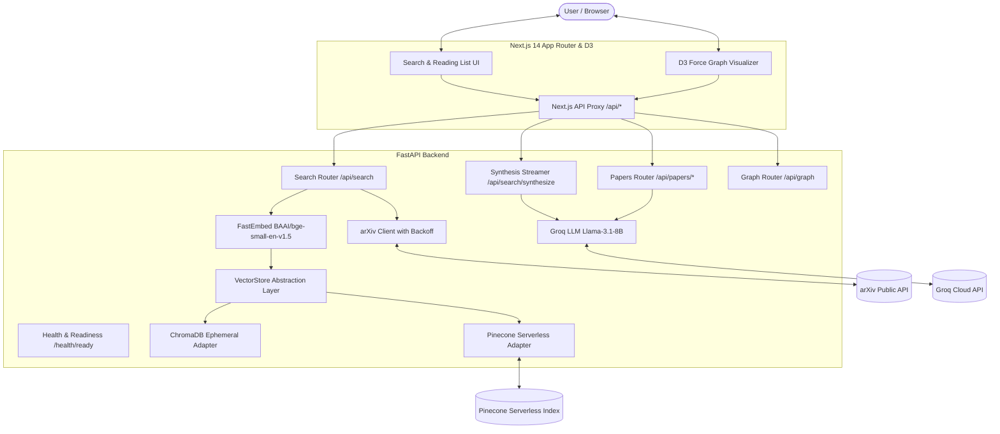

# Scholytics

Scholytics is an intelligent research discovery copilot designed to help students, researchers, and engineers explore academic literature on arXiv. It combines live arXiv candidate retrieval, local semantic reranking with dense embeddings, Groq-hosted LLM summarization and streaming synthesis with inline citations, an interactive D3 force-directed relationship graph, and pluggable vector storage via ChromaDB and Pinecone.

---

## Architecture & System Design



### Request Flow: Discovery, Ingestion & Retrieval

Scholytics separates **Discovery**, **Ingestion**, and **Retrieval** into three decoupled stages to eliminate redundant computation and prevent re-embedding identical candidate papers on repeated searches:

1. **Discovery (arXiv)**: When a query is submitted, the FastAPI backend fetches matching candidate papers from arXiv via `arxiv.Client` with bounded page sizes, exponential retry backoff, and category/date filtering.
2. **Change Detection & Deduplication (Ingestion Service)**: Discovered papers are normalized to canonical arXiv IDs. The ingestion service queries the persistent vector store (`fetch_records`) to inspect existing records:
   - Papers matching stored version and SHA-256 content fingerprints are **skipped** — embedding is avoided entirely.
   - New or updated papers (e.g. revision `v2` or modified abstract) are claimed through an in-memory concurrency coordinator.
   - Up to a bounded batch ($\le 10$ papers per user request) are embedded in memory with FastEmbed (`BAAI/bge-small-en-v1.5`, 384 dimensions) and upserted into Pinecone/Chroma.
3. **Hybrid Retrieval & Reciprocal Rank Fusion (RRF)**: The user's query is routed simultaneously to:
   - **Dense Retrieval**: Encodes query via FastEmbed and ranks vectors by cosine similarity.
   - **Keyword Retrieval**: Tokenizes query and ranks papers using a local in-memory Okapi BM25+ engine.
   - **Fusion**: Fuses both ranked lists using Reciprocal Rank Fusion (RRF) with tuned parameters ($k=10.0, w_{\text{dense}}=1.0, w_{\text{bm25}}=1.0$), ensuring exact technical terms (e.g. *LoRA*, *DPO*, *ViT*) receive a ranking boost without sacrificing semantic generalization.
   - Exact date boundaries and category criteria are verified at the application level before returning results.
4. **Source-Grounded Topic Synthesis**: Users can request a streaming synthesis of selected papers. The backend initiates a Server-Sent Events (`text/event-stream`) stream powered by Groq (`llama-3.1-8b-instant`), enforcing strict system prompt boundaries and requiring inline `[SOURCE N]` citations mapped to the provided paper abstracts.
5. **Interactive Research Graph**: Selected papers are visualized in an interactive D3 force-directed graph with pan, zoom, node dragging, category color-coding, and relationship filtering.

---

## Paper Ingestion & Corpus Seeding

### CLI Ingestion Script
To seed foundational research topics into the persistent index or perform incremental corpus updates without blocking web request lifecycles:

```bash
# Check current index count and active backend
cd backend
python -m scripts.ingest_corpus --status

# Ingest foundational topics (respects arXiv rate limits with 3s delays)
python -m scripts.ingest_corpus --topics "deep learning transformers" "diffusion models" --max-per-topic 10
```

### Ingestion API Endpoints
- `GET /api/ingest/status`: Returns active backend (`pinecone` or `chroma`) and total vector count.
- `POST /api/ingest`: Triggers bounded incremental ingestion by topic query or explicit arXiv IDs:
  ```json
  {
    "query": "graph neural networks",
    "max_papers": 10
  }
  ```

---

## Pluggable Vector Store Architecture

Scholytics decouples the retrieval and indexing pipeline from concrete vector store technologies via a clean `VectorStore` interface (`backend/db/vector_store.py`):

| Feature | ChromaDB (`ChromaAdapter`) | Pinecone (`PineconeAdapter`) |
| :--- | :--- | :--- |
| **Best For** | Local development, CI/CD, offline testing | Production deployment (Render, Fly.io, etc.) |
| **Storage Model** | In-process `EphemeralClient` | Managed serverless cloud index |
| **Persistence** | Reset on process restart | **Durable** across backend sleeping, restarts, and redeployments |
| **Credentials** | None required | `PINECONE_API_KEY` |
| **Dimension / Metric** | 384 dimensions / Cosine | 384 dimensions / Cosine |
| **Activation** | `VECTOR_STORE_BACKEND=chroma` (default) | `VECTOR_STORE_BACKEND=pinecone` |

### Deterministic Vector IDs & Version Policy
To prevent duplicate vectors for the same logical paper when revised versions are published on arXiv (e.g. `2301.00001v1` vs `2301.00001v2`), vector IDs are deterministically derived by stripping trailing version suffixes into canonical IDs (`2301.00001`). Re-indexing or updating a paper overwrites the existing vector in-place.

---

## Tech Stack

| Layer | Technology | Details |
| :--- | :--- | :--- |
| **Backend Framework** | FastAPI (Python 3.12+) | Async endpoints, Pydantic v2 input validation, CORS protection |
| **Vector Database** | Pinecone & ChromaDB | Pluggable vector store layer supporting both Pinecone serverless and ChromaDB ephemeral |
| **Embeddings** | FastEmbed (`BAAI/bge-small-en-v1.5`) | Fast ONNX-based local inference (384 dimensions, normalized) |
| **LLM Inference** | Groq API (`llama-3.1-8b-instant`) | High-speed inference for summaries and streaming SSE synthesis |
| **Frontend** | Next.js 14 (App Router) + TypeScript | React 18, Tailwind CSS, Server-Sent Events stream parser |
| **Visualization** | D3.js v7 (`d3-force`, `d3-zoom`, `d3-drag`) | Interactive graph with physics simulation, zoom, and node inspector |
| **Testing** | pytest, Jest, React Testing Library | 111 backend unit/integration tests; 14 frontend tests; TypeScript & ESLint validation |

---

## Environment Variables

### Backend Configuration (`.env` in root or backend)

| Variable | Required | Default | Description |
| :--- | :---: | :--- | :--- |
| `GROQ_API_KEY` | Yes (for AI) | *None* | Groq API key for LLM paper summaries and synthesis. |
| `GROQ_MODEL` | No | `llama-3.1-8b-instant` | Model name for Groq completions. |
| `VECTOR_STORE_BACKEND` | No | `chroma` | Active vector store adapter: `chroma` or `pinecone`. |
| `PINECONE_API_KEY` | If Pinecone | *None* | Pinecone API key (mandatory when `VECTOR_STORE_BACKEND=pinecone`). |
| `PINECONE_INDEX_NAME` | No | `scholytics-papers` | Target index name in Pinecone. |
| `PINECONE_HOST` | No | *None* | Direct data-plane host URL for Pinecone index (optional optimization). |
| `LOCAL_EMBEDDING_MODEL`| No | `BAAI/bge-small-en-v1.5` | FastEmbed model identifier. |
| `USE_HASH_EMBEDDING_FALLBACK` | No | `false` | Enable deterministic hashing fallback only for offline testing. |
| `FRONTEND_ORIGIN` | No | `http://localhost:3000` | Allowed origin for FastAPI CORS middleware. |

### Frontend Configuration (`frontend/.env.local`)

| Variable | Required | Default | Description |
| :--- | :---: | :--- | :--- |
| `NEXT_PUBLIC_API_URL` | Yes (Prod) | `http://localhost:8000` | Backend API URL used by Next.js API rewrites and direct calls. |

---

## Local Setup & Development

### 1. Prerequisites
- Python 3.11 or 3.12
- Node.js 18+ and npm
- Groq Cloud API key ([console.groq.com](https://console.groq.com/))
- (Optional) Pinecone account ([app.pinecone.io](https://app.pinecone.io/))

### 2. Backend Setup

```bash
# Clone the repository
git clone https://github.com/Viper396/Scholytics.git
cd Scholytics

# Activate virtual environment (Windows PowerShell)
.\.venv\Scripts\Activate.ps1
# Or on Linux / macOS:
# source .venv/bin/activate

# Install dependencies
pip install -r backend/requirements.txt

# Configure environment
cp .env.example .env
# Edit .env and supply your GROQ_API_KEY (and optionally PINECONE_API_KEY)

# Start backend server
cd backend
uvicorn main:app --reload --host 0.0.0.0 --port 8000
```

The backend API will be available at `http://localhost:8000`. Interactive documentation is available at `http://localhost:8000/docs`.

### 3. Frontend Setup

```bash
# In a new terminal window:
cd frontend

# Install dependencies
npm install

# Configure environment
cp .env.example .env.local

# Run Next.js development server
npm run dev
```

The user interface will be available at `http://localhost:3000`.

---

## Automated Verification & Testing

### Backend Test Suite
The test suite contains 111 unit and integration tests covering:
- Vector store abstraction contracts (ChromaAdapter and PineconeAdapter).
- Canonical arXiv ID deduplication and version suffix handling.
- Input sanitization and Pydantic validation.
- arXiv retry policies with backoff.
- Embedder normalization and hash fallback.
- Graph edge construction (co-author and same-field).
- SSE streaming synthesis.
- IR benchmark metrics (Precision@K, Recall@K, MRR, nDCG@K).

```bash
# From repository root using the virtual environment:
.\.venv\Scripts\python.exe -m pytest backend/tests -v
```

### Frontend Tests, Type Checking & Linting

```bash
cd frontend
npm test
npm run lint
npm run build
```

---

## Deployment & Production Readiness (Render + Vercel)

### Backend (Render Free Tier)
1. In the Render Dashboard, create a new **Web Service** connected to your repository.
2. Settings:
   - **Runtime**: Python 3
   - **Root Directory**: `backend` (or leave empty if using root `backend/requirements.txt`)
   - **Build Command**: `pip install -r backend/requirements.txt`
   - **Start Command**: `uvicorn main:app --host 0.0.0.0 --port $PORT`
3. Environment Variables:
   - `GROQ_API_KEY`: your Groq API key
   - `VECTOR_STORE_BACKEND`: `pinecone`
   - `PINECONE_API_KEY`: your Pinecone API key
   - `PINECONE_INDEX_NAME`: `scholytics-papers`
   - `FRONTEND_ORIGIN`: `https://your-scholytics-frontend.vercel.app`

### Pinecone Free Tier Index Setup
Create a free serverless index in the [Pinecone Console](https://app.pinecone.io/):
- **Index Name**: `scholytics-papers`
- **Dimensions**: `384`
- **Metric**: `cosine`
- **Cloud Provider**: `AWS`
- **Region**: `us-east-1` (or your preferred free-tier region)

### Frontend (Vercel)
1. Import repository into Vercel.
2. Root Directory: `frontend`
3. Environment Variable: `NEXT_PUBLIC_API_URL=https://your-scholytics-backend.onrender.com`

### Health & Observability Endpoints
- **Liveness Check**: `GET /` — Returns `{"status": "ok"}` when process is running.
- **Readiness Check**: `GET /health/ready` — Checks vector store initialization, active backend (`chroma` or `pinecone`), and Groq API key presence without unmetered external calls.
