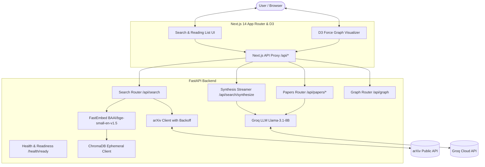

# Scholytics

Scholytics is an intelligent research discovery copilot designed to help students, researchers, and engineers explore academic literature on arXiv. It combines live arXiv candidate retrieval, local semantic reranking with dense embeddings, Groq-hosted LLM summarization and streaming synthesis with inline citations, and an interactive D3 force-directed relationship graph.

---

## Architecture & System Design



### Request Flow

1. **Candidate Retrieval**: When a user submits a query, the FastAPI backend queries the official arXiv API via `arxiv.Client` using bounded page sizes, relevance sorting, and category/date filtering. Upstream network failures are handled with exponential backoff (`3` retries, base `1.5s`).
2. **Dense Vector Indexing**: Retrieved candidate papers (title + abstract) are embedded in memory using FastEmbed (`BAAI/bge-small-en-v1.5`, 384-dimensional dense vectors) with L2 normalization.
3. **Semantic Reranking**: Papers are indexed into an ephemeral ChromaDB collection configured in cosine similarity space (`hnsw:space: cosine`). The query is embedded, and candidates are reranked by semantic similarity:
   $$\text{relevance\_score} = \max(0.0, \min(1.0, 1.0 - \text{cosine\_distance}))$$
4. **Source-Grounded Topic Synthesis**: Users can request a streaming synthesis of selected papers. The backend initiates a Server-Sent Events (`text/event-stream`) stream powered by Groq (`llama-3.1-8b-instant`), enforcing strict system prompt boundaries and requiring inline `[SOURCE N]` citations mapped to the provided paper abstracts.
5. **Interactive Research Graph**: Selected papers are visualized in an interactive D3 force-directed graph with pan, zoom, node dragging, category color-coding, and relationship filtering.

---

## Important Architectural Distinctions & Trade-offs

### 1. arXiv Candidate Retrieval vs. Corpus Semantic Search
Scholytics does **not** pre-index the entire arXiv catalog (which comprises millions of documents). Instead, it implements a **two-stage retrieval pipeline**:
- Stage 1: The arXiv API retrieves the top candidate papers matching the user query and metadata filters.
- Stage 2: Scholytics computes dense embeddings over candidate abstracts and performs local semantic reranking via vector distance against the query vector.
*Benefit*: High data freshness (papers published today are immediately searchable) without the massive operational cost and storage overhead of scraping and indexing all of arXiv.

### 2. Meaning of Graph Edges
The arXiv public API does **not** expose a citation graph traversal endpoint. Therefore, Scholytics constructs relationship edges based on verified paper metadata:
- **`co-author` edges**: Two papers share at least one author (edge weight = number of shared authors).
- **`same-field` edges**: Two papers share at least one primary arXiv category tag (edge weight = number of shared categories).
*Honesty Note*: Graph edges represent author collaboration and domain overlap, **not** direct scholarly citations.

### 3. Vector Store Lifecycle & Persistence
ChromaDB runs in-memory using `chromadb.EphemeralClient()`. 
- Embeddings are generated dynamically per search and indexed for the duration of the server process.
- If the backend process restarts, the in-memory Chroma collection resets. Vectors are not persisted across deployments. This is an intentional design choice to maintain zero-state serverless/container simplicity without requiring dedicated persistent disk volumes.

### 4. Graceful Degradation & Fallback Strategy
- **Missing / Degraded Embedding Model**: If FastEmbed cannot be loaded or is offline, the backend does not crash. It returns the arXiv candidate papers with `relevance_score: null` and `ranking_degraded: true`, accompanied by an explicit user-facing notice. An optional hash-based embedding fallback (`USE_HASH_EMBEDDING_FALLBACK=true`) is available strictly for offline development/testing.
- **Groq API Outage**: If Groq credentials are missing or the API encounters errors, individual summaries gracefully display `"Summary unavailable."`, and synthesis streams emit structured error events rather than terminating abruptly.

---

## Tech Stack

| Layer | Technology | Details |
| :--- | :--- | :--- |
| **Backend Framework** | FastAPI (Python 3.12+) | Async endpoints, Pydantic v2 input validation, CORS protection |
| **Vector Database** | ChromaDB (`EphemeralClient`) | In-memory dense vector store with cosine space indexing |
| **Embeddings** | FastEmbed (`BAAI/bge-small-en-v1.5`) | Fast ONNX-based local inference (384 dimensions, normalized) |
| **LLM Inference** | Groq API (`llama-3.1-8b-instant`) | High-speed inference for summaries and streaming SSE synthesis |
| **Frontend** | Next.js 14 (App Router) + TypeScript | React 18, Tailwind CSS, Server-Sent Events stream parser |
| **Visualization** | D3.js v7 (`d3-force`, `d3-zoom`, `d3-drag`) | Interactive graph with physics simulation, zoom, and node inspector |
| **Testing** | pytest, unittest.mock, ESLint | 44 comprehensive backend unit tests; strict TypeScript & ESLint validation |

---

## Environment Variables

### Backend Configuration (`.env` in root or backend)

| Variable | Required | Default | Description |
| :--- | :---: | :--- | :--- |
| `GROQ_API_KEY` | Yes (for AI) | *None* | Groq API key for LLM paper summaries and synthesis. |
| `GROQ_MODEL` | No | `llama-3.1-8b-instant` | Model name for Groq completions. |
| `LOCAL_EMBEDDING_MODEL`| No | `BAAI/bge-small-en-v1.5` | FastEmbed model identifier. |
| `USE_HASH_EMBEDDING_FALLBACK` | No | `false` | Enable deterministic hashing fallback only for offline testing. |
| `FRONTEND_ORIGIN` | No | `http://localhost:3000` | Allowed origin for FastAPI CORS middleware. |

### Frontend Configuration (`frontend/.env.local`)

| Variable | Required | Default | Description |
| :--- | :---: | :--- | :--- |
| `NEXT_PUBLIC_API_URL` | Yes (Prod) | `http://localhost:8000` | Backend API URL used by Next.js API rewrites and direct calls. |

---

## Local Setup & Development

### 1. Prerequisites
- Python 3.11 or 3.12
- Node.js 18+ and npm
- Groq Cloud API key ([console.groq.com](https://console.groq.com/))

### 2. Backend Setup

```bash
# Clone the repository
git clone https://github.com/Viper396/Scholytics.git
cd Scholytics

# Activate virtual environment (Windows PowerShell)
.\.venv\Scripts\Activate.ps1
# Or on Linux / macOS:
# source .venv/bin/activate

# Install dependencies
pip install -r requirements.txt

# Configure environment
cp .env.example .env
# Edit .env and supply your GROQ_API_KEY

# Start backend server
cd backend
uvicorn main:app --reload --host 0.0.0.0 --port 8000
```

The backend API will be available at `http://localhost:8000`. Interactive documentation is available at `http://localhost:8000/docs`.

### 3. Frontend Setup

```bash
# In a new terminal window:
cd frontend

# Install dependencies
npm install

# Configure environment
cp .env.example .env.local

# Run Next.js development server
npm run dev
```

The user interface will be available at `http://localhost:3000`.

---

## Automated Verification & Testing

### Backend Unit Tests
The test suite contains 44 unit tests covering input sanitization, Pydantic validation, arXiv retry policies, embedder normalization, graph edge construction, and SSE event streaming:

```bash
# From repository root using the virtual environment:
.\.venv\Scripts\python.exe -m pytest backend/tests -v
```

Expected output:
```text
======================== 44 passed, 1 warning in 1.29s ========================
```

### Frontend Type Checking & Linting
Validate TypeScript contracts and ESLint compliance:

```bash
cd frontend
npm run lint
```

Expected output:
```text
✔ No ESLint warnings or errors
```

### Production Build Validation
Verify Next.js static page generation and bundle compilation:

```bash
cd frontend
npm run build
```

Expected output:
```text
✓ Compiled successfully
✓ Generating static pages (6/6)
Finalizing page optimization ...
```

---

## Deployment & Production Readiness

### Architecture on Cloud Providers (e.g., Render + Vercel)
- **Frontend (Vercel)**:
  - Framework Preset: Next.js
  - Root Directory: `frontend`
  - Environment Variable: `NEXT_PUBLIC_API_URL=https://your-scholytics-backend.onrender.com`
  - All `/api/*` requests are securely rewritten to the backend via `frontend/next.config.js`.
- **Backend (Render / Railway / Fly.io)**:
  - Runtime: Python 3.12
  - Build Command: `pip install -r requirements.txt`
  - Start Command: `uvicorn backend.main:app --host 0.0.0.0 --port $PORT`
  - Environment Variables:
    - `GROQ_API_KEY`: production Groq key
    - `FRONTEND_ORIGIN`: `https://your-scholytics-frontend.vercel.app`
    - `LOCAL_EMBEDDING_MODEL`: `BAAI/bge-small-en-v1.5`

### Health & Observability Endpoints
- **Liveness Check**: `GET /` — Returns `{"status": "ok"}` when the process is up.
- **Readiness Check**: `GET /health/ready` — Checks ChromaDB collection initialization and Groq API key presence without firing unmetered external calls.

---

## Current Limitations & Roadmap

1. **Candidate Retrieval Dependency**: Scholytics retrieves candidate papers through arXiv's public API. If arXiv experiences rate-limiting or service degradation, candidate sets may be throttled despite exponential backoff.
2. **Abstract-Level Context**: The RAG pipeline and topic synthesis currently index and evaluate abstracts rather than complete 20-page PDF manuscripts. A planned enhancement is chunked PDF parsing with section-level citations.
3. **Graph Topology**: Relationship edges currently reflect shared authorship and shared subject domains. Integrating Semantic Scholar or OpenAlex citation graph APIs would allow true bi-directional citation tree traversal.
4. **Local Vector Lifespan**: Vector collections reside in ephemeral memory. For multi-tenant production scaling, connecting ChromaDB to an external persistent vector cluster (or Qdrant/Pinecone) is recommended.
